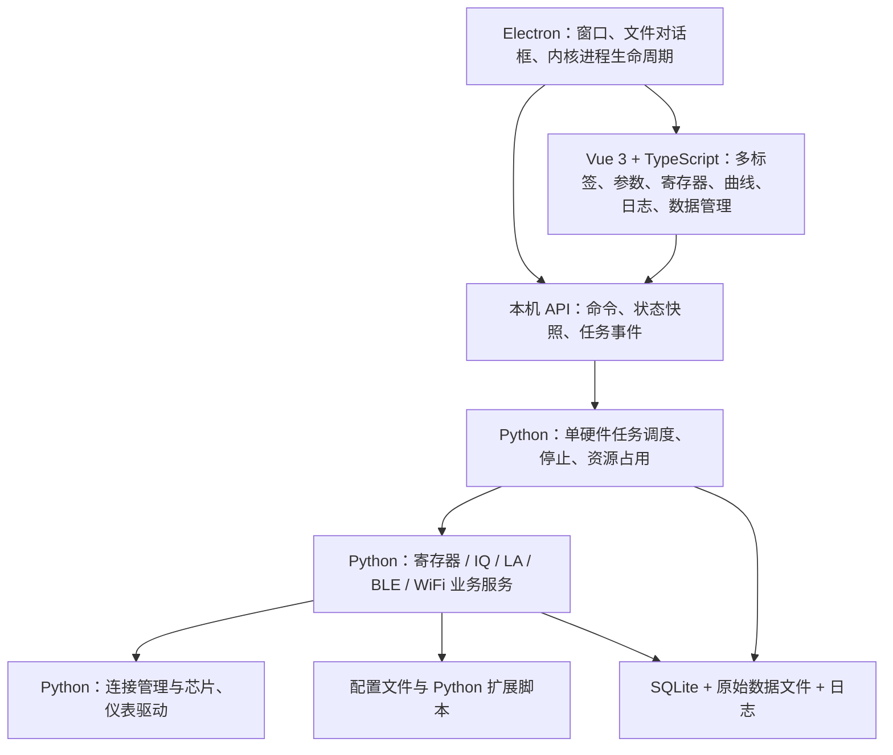

# TestStudio 需求与技术架构选型

> 日期：2026-10-29
> 状态：Draft，供用户审阅，尚未开始实现
> 来源：现有项目代码、用户功能描述、多轮需求采访及官方技术文档。
> 本文区分“用户已确认需求”和“建议方案”。技术建议、阶段划分和未决项不代表用户已批准。

## 1. 项目概述

Test Studio 是运行在 Windows 本机的芯片调试与射频测试工作台，通过统一的串口、仪表连接，提供寄存器操作、IQ 采集分析与回放、LA 采集与波形查看、BLE/WiFi 测试、日志及测试数据管理。

用户提供寄存器配置方法、测试思路、算法与脚本规则，软件主要由 AI 开发实现。用户熟悉 Python、C，不熟悉前端和 GUI 设计；技术选型优先方便 AI 实现、观察、调试与验证。

### 1.1 独立重构与参考边界

- 新版项目目录为 `C:\workspace\TestStudio`，使用独立 Git 仓库、依赖环境、配置、数据库和运行数据。
- 用户要求全新重构，不在旧版仓库的分支或 worktree 中开发新版，也不共享旧版 Git 历史和远程仓库配置。
- 旧版 `C:\workspace\test_studio` 仅作只读参考：界面为 NiceGUI + ex4nicegui，入口 `http://127.0.0.1:8081/`；包含 IQ、NF、增益扫描、BLE PER/灵敏度、寄存器对比、日志和历史数据等能力。
- 旧版 Python 3.9.12、NiceGUI 3.0.4、ex4nicegui 0.9.0 是参考环境记录，不作为新版版本约束。
- `C:\workspace\test_stuio_new` 仅作为寄存器交互、位域定义和通信流程的只读参考。
- 新版按独立架构重新实现已有能力，可参考协议、命令、算法和预期行为；明确选用的组件或算法需在新版内完成适配和验证，并记录来源。
- 禁止通过跨目录导入、符号链接、`PYTHONPATH` 或共享虚拟环境让新版依赖旧仓库；不直接使用或修改旧版数据库及配置。
- 本文中的“迁移”均指在新版独立实现并验证对应功能，不表示整体复制旧项目或建立运行时依赖。
- 当前阶段只建立文档和仓库边界，尚未开始功能代码开发。

## 2. 用户已确认的约束

| 事项 | 已确认要求 |
| --- | --- |
| 使用方式 | Windows 本机使用，无已确认的远程访问或多用户需求 |
| 公司电脑 | Windows 10，不能依赖常规软件安装流程 |
| 允许方式 | 解压运行便携 EXE；可使用 Python 虚拟环境、安装新 Python 包及开源免费开发工具 |
| 联网 | 可以联网下载开发依赖 |
| 日常体验 | 双击打开桌面窗口，无需手动打开浏览器 |
| 启动目标 | 可接受 5～10 秒出现可操作主界面，设备连接及文件加载另计 |
| 包体积 | 几百 MB 可以接受 |
| 维护方式 | AI 负责实现，用户提供测试领域知识；可采用混合语言 |
| 界面风格 | 现代开发工具风格，参考 VS Code 的工作台组织方式 |
| 工作区 | 类似浏览器的多标签，按需打开模块 |
| 日志 | 可放在底部、关闭面板，也可作为独立标签打开 |
| 硬件任务 | 全局单任务，可在切换标签后后台执行 |
| 功能扩展 | 配置文件和 Python 脚本为主 |
| 现有外部依赖 | 已知主要是 Python 脚本，其他厂商 SDK/DLL 依赖尚未完整确认 |
| 数据管理 | 历史记录管理，以及芯片、批次、条件等维度的结果对比 |
| 源码 | 通用框架可以开源，芯片配置、算法和测试脚本需要支持私有维护 |

### 2.1 数据规模

- IQ：默认 4096 组 I/Q，最大 32768 组 I/Q。
- 已明确的 IQ 交互是有限长度 RAM 采集与回放；尚无必须连续流式显示的要求。
- LA：VCD 文件在几十 MB 以内；信号数、跳变密度仍需实际文件验证。
- 已有 LA RAM HEX 数据转换为 VCD 的脚本，具体文件位置、语言和依赖待提供。

## 3. 功能需求

优先级为建议：P0=首期基础或迁移重点；P1=后续主要能力；P2=进阶能力。用户选择的首期重点是桌面界面与 AI 调试、共享连接与寄存器、IQ 采集与回放、迁移现有功能。

| 功能 | 范围 | 建议优先级 |
| --- | --- | --- |
| 桌面工作台 | 双击启动、多标签、状态展示、底部及标签日志 | P0 |
| 连接中心 | 统一配置和管理多个串口及仪表连接，各模块复用 | P0 |
| 寄存器操作 | 地址和寄存器列表、整字读写、bit/位域展示与编辑 | P0 |
| 多芯片寄存器配置 | 复用多个连接，配置下发，以及现有对比与同步能力 | P0 |
| IQ 采集分析 | RxDump 配置、RAM 读回、频谱、时域、功率及噪声分析 | P0 |
| IQ 数据回放 | 加载 TXT 或生成正弦波，写入 RAM，由硬件读取播放 | P0 |
| 原有测试能力迁移 | NF、增益扫描、BLE PER、灵敏度、历史记录等 | P0 |
| 统一任务与日志 | 后台单硬件任务、进度、停止、错误、日志关联 | P0 |
| 数据记录基础 | 保存任务参数、结果与原始数据关联 | P0 |
| 结果对比 | 按芯片、批次、测试条件查询和比较结果 | P1 |
| LA 采集和转换 | 串口采集 RAM 数据，调用已有脚本转换 VCD | P1 |
| LA 波形查看 | 信号树、波形、搜索、游标、分组、视图保存、模拟显示及测量 | P1 |
| WiFi 测试 | 已确认需要该模块，具体测试项目和仪表流程待细化 | P1 |
| 帮助和关于 | 版本、使用说明、更新入口；更新方式待确定 | P1 |
| 协议解码扩展 | 为 LA 协议解码预留 Python 扩展接口，协议清单待确定 | P1 |
| IQ 解调 | 根据后续需求增加具体制式的 IQ 解调 | P2 |

### 3.1 共享连接

- 连接由应用内核持有，页面通过逻辑设备标识使用连接服务。
- 页面切换、前端热更新不应主动关闭硬件连接。
- 测试任务结束时释放占用，不默认关闭连接；异常断线单独处理。
- 同一物理串口不得由不同页面或脚本重复打开。
- 必须协调手动寄存器读写与采集、测试任务的冲突。
- 连接中心显示连接状态与使用状态；设备断线应通知所有相关模块。
- 多芯片配置可在一个硬件任务中依次操作多个连接，符合全局单任务约束。

### 3.2 IQ 的两种流程

**采集分析**：Test Studio 配置 SoC 进入 RxDump 模式 → 硬件采集 IQ 到 RAM buffer → 串口读回 → 频谱、时域、功率和噪声分析 → 后续扩展解调。

**数据回放**：加载 TXT 或在 Test Studio 中生成指定采样率、指定频率的正弦波 → 转换为硬件需要的数据格式 → 串口写入 RAM buffer → 配置硬件读取并播放。

待细化：TXT 格式、I/Q 排列、量化位宽、幅度、RAM 地址和容量、回放启动与停止命令，以及正弦波的实数/复数定义。

### 3.3 LA 波形能力

- 信号层级树、信号添加/移除、排序、分组和保存视图。
- 单 bit、总线、`0/1/X/Z`、不同数值进制。
- 缩放、平移、时间跳转、双游标和时间差。
- 前后跳变定位、信号名和数值搜索、条件定位。
- 数字总线按数值转换为模拟曲线；符号解释及缩放方式待细化。
- 频率测量；游标测量与选区统计的具体规则待细化。
- 协议解码通过扩展接口实现，可以参考开源逻辑分析仪项目。
- 波形组件应支持独立打开 VCD，不与硬件采集流程绑定。

### 3.4 寄存器模块的参考项目

用户指定 `C:\workspace\test_stuio_new` 的寄存器读写界面及截图作为参考。已只读查看源码，未启动该项目或操作硬件。以下记录区分已观察行为与新版建议，不表示所有旧行为必须照搬。

**已定位的主要文件**：

| 文件，相对于参考项目根目录 | 参考价值 |
| --- | --- |
| `serial_vue/src/views/register/Register.vue` | 截图对应的寄存器表、单行/批量读写、十六进制值联动、表管理及导入导出 |
| `serial_vue/src/views/register/components/BitEditor.vue` | 独立的 32 位编辑组件、位域颜色、说明和只读位处理 |
| `serial_vue/src/api/register_api.ts` | Vue 与 Python 的读写、批量操作和 Excel 导入接口 |
| `serial_python/app/controllers/register_controller.py` | Excel 位域定义解析、寄存器通信流程 |

**已观察的交互**：

- 一行显示选择框、序号、地址、十六进制值、操作按钮、32 位编辑器和寄存器说明。
- bit31 在左、bit0 在右，按 8 个四位块分隔；位号和 0/1 同时显示。
- 逻辑位域使用不同底色，保留位为灰色；悬浮显示字段名、`[msb:lsb]` 和描述。
- 单 bit 点击翻转，与整字十六进制值双向联动；全 0/全 1 只修改组件判定为可编辑的位。
- 已标注为 RO 或 Reserved 的位禁止点击；没有字段定义的位在参考组件中默认可编辑。
- 点 bit 或编辑十六进制值只修改页面待写值；显式点击“写入”才发送整字写命令。
- 读取成功后更新十六进制值及 32 位显示。“保存”配置与写入硬件是不同操作。
- 支持勾选多行批量读写、行拖拽排序，以及寄存器表新建、重命名、删除和切换。
- Excel 导入按 sheet 建表并加载字段；JSON 导入导出主要保存地址、数据和说明。
- Excel 解析使用 B2 基地址、第 4 行表头，以及“名称、偏移地址、成员变量、位域、类型、初始值、成员描述”等列；参考字段定义的 `start_bit` 表示高位，`end_bit` 表示低位。

**新版的建议与复用边界**：

- `BitEditor.vue` 与推荐的 Vue/TypeScript 架构匹配，可作为复用候选；参考工程的其他页面或桌面外壳不因此成为既定依赖。
- 保留横向逐 bit 编辑和十六进制联动，采用“编辑待写值 → 显式提交”的交互基线；多 bit 字段数值输入/枚举编辑可后续补充。
- 明确区分硬件读回值、待写值、未提交修改、读取失败、写命令完成与读回校验结果，避免把尚未写入的值展示成硬件实值。
- 位域编辑由内核根据地址、位掩码及访问属性执行。普通 RW 位按设备规则保留其他位；W1C 等字段按各自语义处理，不能统一套用读改写。
- RO/保留位限制不能仅靠 bit 按钮禁用，整字输入、批量写和脚本调用也必须经过相应内核检查；缺少字段定义时的原始读写策略待确定。
- 参考页面虽在写入后延时读取，但没有比较期望值与读回值；新版应对可验证字段按有效掩码比较，并区分不可读回/自清零字段。
- 批量写必须保持约定的顺序与应答处理；参考后端普通批量写路径并发发送、不逐项等待确认，不能直接作为新版的可靠写入实现。
- 寄存器页复用连接中心的逻辑设备；参考页面内的串口连接控件改为设备选择与状态展示。
- 寄存器定义、表及预置配置由 Python 持久化并支持导入导出；参考项目 localStorage 和 JSON 导出不能完整保留同样的定义信息，不作为唯一保存方式。
- 布局需验证常用窗口宽度：32 位编辑器保持可读，表格按需横向滚动，并考虑大量寄存器行的渲染开销。

## 4. 推荐技术架构

**推荐组合：Electron + Vue 3/TypeScript + 独立 Python 内核（FastAPI）+ SQLite。**

这是基于当前需求的推荐，尚需原型验证和用户审阅。主架构与图表、LA 查看器等具体组件分开决策。

### 4.1 职责划分

### 4.2 技术选择及理由

| 部分 | 建议 | 理由与边界 |
| --- | --- | --- |
| 桌面外壳 | Electron | 自带 Chromium，支持便携目录；便于桌面自动化及开发工具检查。代价是较大的内存和包体积 |
| 前端 | Vue 3 + TypeScript + Vite | 组件化界面、成熟调试链；类型检查有助于 AI 修改后发现接口错误。React 同样可行，Vue 是一致性选择，并非独有能力 |
| 前端状态 | Pinia | 管理标签及显示状态；连接、任务和结果的权威状态仍在 Python 内核 |
| 本机接口 | FastAPI + Pydantic + Uvicorn | 参数校验、API 文档和类型定义方便分别调试前后端 |
| 事件 | WebSocket | 推送连接状态、任务进度、结果通知和批量日志；断开后通过状态快照恢复 |
| 任务执行 | Python 内核中的单任务执行器 | 串口与 VISA 阻塞调用移出 API 事件循环；重型离线计算按需使用独立进程 |
| 硬件 | PySerial、PyVISA 及驱动适配层 | 复用现有 Python 生态与业务经验，避免把设备协议分散到前端 |
| 算法 | NumPy，其他 DSP 库按需求引入 | 复用现有分析；GUI 与算法返回的数据结构解耦 |
| 存储 | SQLite + 外部数据文件 | SQLite 保存元数据、参数、指标及索引；IQ/LA/VCD 文件按记录关联 |
| UI 组件和图表库 | 原型阶段确定 | 先验证寄存器表编辑及 32768 点曲线交互；不为选型提前堆叠多个库 |
| LA 查看器 | 独立组件，先评估复用 | 需要验证现成实现的嵌入接口、许可证、功能和性能，暂不承诺复用某个项目 |
| Python 运行时 | 独立且固定版本，随便携包提供 | 避免依赖使用者的全局 Python；具体版本待脚本及厂商依赖检查后锁定 |
| 打包 | Electron 便携目录 + Python 运行目录 | 用户解压后双击；优先目录式交付，具体 Python 打包工具经验证后确定 |

### 4.3 本机通信与进程

- 一个 Electron 主进程负责桌面窗口和 Python 内核启动、就绪检测、退出清理。
- 一个 Python 内核持有连接、任务状态和数据库服务；正式运行不启用热重载或多个 Uvicorn worker，避免重复持有设备。
- 本机 HTTP API 处理命令和查询，WebSocket 推送事件；大块波形数据按需批量获取。
- 接口绑定回环地址，运行会话使用受控来源与会话凭据；端口选择不能硬编码为永不冲突的固定值。
- 前端只通过定义好的接口调用业务，不直接持有串口、VISA 连接或任意文件执行权限。
- Electron 原生文件操作通过有限的桥接接口提供；普通浏览器开发模式提供对应适配。
- 业务服务与 HTTP 层分离，便于 Python 单独运行、测试和脚本复用。

### 4.4 标签、任务和资源状态

- 模块按需加载，关闭或切换日志面板不停止日志采集。
- 切换标签不停止硬件任务；关闭运行中标签和退出软件的具体行为仍需确认。
- 任务启动时校验参数并保存参数快照，不持续读取前端正在编辑的表单。
- 全局仅允许一个硬件任务执行；寄存器手动操作同样遵守设备占用规则。
- 同一连接的命令由内核串行执行，包含多条命令的采集流程应保持任务级占用。
- 停止采用协作式取消、超时与必要的硬件清理，不通过关闭页面或随意终止线程取消。
- 离线计算不能阻塞界面及状态事件；与硬件任务并发的策略留待实际需求确定。

## 5. 候选方案取舍

| 候选方案 | 优点 | 在本项目中的取舍 |
| --- | --- | --- |
| Electron + Vue + Python | 浏览器调试链完善、自带渲染内核、便携交付、适合多标签工作台 | 首选；需要接受前后端接口维护和运行资源开销 |
| Python WebView + Vue + Python | 同样能使用 Web 界面，Python 主导桌面外壳，并支持远程调试 | 备选；Windows 渲染运行时、桥接及便携分发需额外验证，不能认为它无法自动化 |
| Tauri + Vue + Python | Web 界面、桌面能力，复用 WebView2 时包体积较小 | 暂不首选；增加 Rust/MSVC 构建链，WebView2 分发也需考虑。自带运行时后体积优势减小 |
| PySide6 + Qt Widgets | 本地桌面交互、表格、窗口布局和 Python 维护便利 | 可实现需求；当前更重视现有 AI 浏览器工具直接检查 DOM/CSS 与操作的便利性 |
| 继续 NiceGUI | 最少迁移、保留 Python 开发与浏览器检查能力 | 适合短期优化；本次建议建立独立前端和领域内核，为复杂工作台及 LA 查看提供清晰边界 |

Electron 的选择不保证天然启动更快或界面更流畅，仍需按需加载、后台执行、减少无效渲染和实际测量。外观质量主要由布局和组件设计决定。

## 6. 数据与扩展设计

### 6.1 建议的数据对象

- 连接配置：逻辑设备 ID、类型、参数、芯片/仪表适配器；运行状态单独管理。
- 寄存器描述：分组、地址、宽度、字段位域、访问属性、说明及可用的枚举值。
- 任务记录：任务 ID、测试类型、设备、参数快照、时间、状态、错误和版本信息。
- 测试结果：指标值、单位、条件及原始文件关联，支持跨记录对比。
- IQ/LA 数据：保存格式、采样率、长度、量化/时基等元数据和原始文件。
- LA 视图：信号列表、顺序、分组、颜色、数值格式、游标和显示方式。
- 日志：时间、级别、设备 ID、任务 ID、消息及必要诊断信息。

### 6.2 Python 脚本接口方向

- 脚本通过明确接口获取参数、连接服务、日志、进度、停止信号和输出目录。
- 寄存器映射和芯片参数优先使用版本化配置；采集转换、测试流程、解码算法使用 Python 脚本。
- 纯转换与分析脚本不依赖 GUI；涉及硬件的脚本复用连接服务，不自行重复打开端口。
- 通用框架和私有芯片资源分离组织；新增复杂 GUI 仍通过项目代码扩展。
- 首期不建设任意前端插件安装系统。
- 外部脚本及其额外依赖的便携部署方式，需要与 Python 打包方案一同验证。

### 6.3 波形数据处理方向

- IQ 在 Python 内完成计算，前端接收曲线数据和指标；保留全分辨率数据用于测量与局部查看。
- VCD 文件大小不能直接等同于内存占用和显示成本，需使用真实信号数、跳变密度验证。
- LA 解析和重型索引计算移出界面主线程；波形按可见范围与可见信号绘制。
- 时间戳采用可保留 VCD 时间精度的表示，避免大整数在 JavaScript 中静默丢失精度。
- 总线显示保留位宽和 X/Z 信息；模拟显示明确有符号/无符号及缩放规则。

## 7. AI 调试与验证

- 同一套 Vue 界面支持普通浏览器开发预览和 Electron 桌面运行。
- 开发模式提供模拟连接、寄存器、IQ 和任务事件，不要求 GUI 排版调试连接真实硬件。
- 重要操作有可访问名称和稳定定位标识；状态不能只用颜色或图像表达。
- Canvas 波形同时提供可读取的信号名、时间范围、游标和当前值，便于自动验证。
- 浏览器工具用于 DOM/CSS、截图、交互、控制台和网络检查。
- Playwright 可用于 Web 交互验证；其 Electron 专用自动化 API 当前仍标注 experimental，需锁版本并验证。
- 桌面文件对话框、窗口行为、便携启动和内核退出清理在 Electron 环境单独检查。
- 硬件正确性需用设备实测验证，模拟界面测试不能替代寄存器及仪表行为验证。

## 8. 边界、风险及待验证项

| 项目 | 处理方向 |
| --- | --- |
| 启动性能 | 5～10 秒作为目标，先测便携原型；区分主界面、内核就绪和设备连接时间 |
| 公司环境 | 在目标 Windows 10 上验证便携 EXE、子进程和回环通信可用 |
| VISA/串口驱动 | 应用便携不等于硬件驱动便携；复用现有可用驱动，核对后端和厂商依赖 |
| Python 版本 | 未锁定；先检查现有脚本及 SDK，避免直接依赖旧环境或未经验证升级 |
| 连接异常 | 失败、超时、断线应有统一状态；不在未知硬件状态下无条件自动重试写操作 |
| 寄存器字段写入 | 依据访问属性处理 RO、W1C 等语义，不能对所有字段使用通用读改写 |
| LA 组件 | Surfer、VaporView、sigrok 相关项目仅为调查对象，不是已选依赖 |
| 开源复用 | 核对具体版本许可证与集成方式；通用框架可开源不等于私有脚本可公开 |
| WiFi/解调范围 | 测试项目、仪表型号、制式与算法输入输出尚未细化 |
| 更新 | 更新来源、离线替换/在线更新及数据保留方式待确定，不在首期自动更新 |
| 标签行为 | 同模块多实例、关闭运行中标签、退出时任务处理待交互设计阶段确认 |
| 历史数据 | 先检查现有数据库结构与文件，设计兼容导入，避免覆盖现有结果 |

以下能力不作为首期前提：远程多人访问、跨平台、并行硬件测试、完整任意插件系统、完整复制商业 EDA 软件，以及尚未明确的连续 IQ/LA 流式显示。

## 9. 建议验证及开发路线

### 9.1 架构验证原型

在实际功能迁移前，验证以下内容；本次采访不开始原型实现。

1. Windows 10 便携目录双击启动，记录界面及 Python 内核就绪时间。
2. 多标签和底部/标签日志，以模拟数据验证 AI 定位、点击、截图和排版检查。
3. 一条共享串口连接服务，验证切换页面后保持连接，冲突操作由任务层协调。
4. 32768 点 IQ 曲线、寄存器位域编辑及代表性几十 MB VCD 的加载和交互。
5. 原生文件操作、后端异常及退出清理；评估包体积和进程内存。

### 9.2 首个可用版本

- 桌面工作台、连接中心、任务及日志基础。
- 寄存器整字/字段读写，以及多芯片配置和现有对比/同步。
- IQ 采集分析、已有文件处理、数据写入与硬件回放。
- 迁移 NF、增益扫描、BLE PER/灵敏度和已有数据查看。
- 为上述功能统一保存参数、指标和原始数据关联。

### 9.3 后续版本

- LA 采集转换、完整波形交互及协议解码接口。
- 测试结果对比，WiFi 测试，使用说明及更新流程。
- 根据明确需求加入 IQ 解调、更多芯片和仪表适配。

## 10. 选型依据

以下为 2026-10-29 查阅的官方资料及项目说明，不代表已经完成目标环境运行验证。

- [Electron 进程模型](https://www.electronjs.org/docs/latest/tutorial/process-model)
- [Electron 性能建议](https://www.electronjs.org/docs/latest/tutorial/performance)
- [Electron 自动化测试](https://www.electronjs.org/docs/latest/tutorial/automated-testing)
- [Playwright Electron API：experimental](https://playwright.dev/docs/api/class-electron)
- [Tauri Windows 构建前提](https://v2.tauri.app/start/prerequisites/)
- [Tauri Windows/WebView2 分发](https://v2.tauri.app/distribute/windows-installer/)
- [pywebview 运行依赖](https://pywebview.flowrl.com/guide/installation)
- [pywebview 远程调试](https://pywebview.flowrl.com/guide/debugging)
- [Vue TypeScript 与 Vite](https://vuejs.org/guide/typescript/overview.html)
- [FastAPI 功能与 OpenAPI](https://fastapi.tiangolo.com/features/)
- [Surfer 项目与许可证](https://surfer-project.org/)
- [VaporView 功能与许可证](https://github.com/Lramseyer/vaporview)
- 本地交互参考：`C:\workspace\test_stuio_new\serial_vue` 寄存器页面与位编辑组件，以及 `serial_python` 的 Excel 定义解析和通信代码（2026-10-29 只读查看）。
